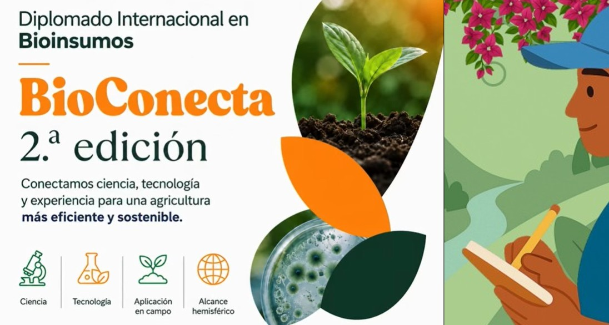

Un grupo coordinado de diez profesionales venezolanos, pertenecientes a distintas instituciones del sector público y privado, están participando en la prestigiosa segunda edición del **Diplomado Internacional en Bioinsumos – BioConecta 2026.**

Esta capacitación conjunta representa un paso estratégico para acelerar la transformación del sistema agroalimentario venezolano y promover el desarrollo de la bioeconomía en el país.

El diplomado es promovido por la **Plataforma Hemisférica de Bioinsumos**, con el respaldo de acreditadas instituciones de América y Europa. El programa cuenta con un plan de estudios riguroso estructurado en 9 módulos especializados, que abarcan 158 horas de capacitación y 20 horas adicionales de sesiones virtuales en vivo con expertos internacionales. Al culminar la formación, los participantes recibirán una certificación oficial expedida por el **CATIE (Centro Agronómico Tropical de Investigación y Enseñanza).**

**Aportes clave para el campo venezolano**

La incorporación de esta cohorte diversa y multidisciplinaria (que incluye perfiles como investigadores, técnicos y extensionistas pertenecientes a  *INSAI-Portuguesa, UCLA-Agronomía, FAGRO-UCV, BIODELTA C.A., Bodegas POMAR C.A., MOLIPASA, FUSAGRI y FUNDACITE YARACUY*), busca generar un impacto multiplicador en el agro nacional. El conocimiento técnico adquirido se traducirá directamente en capacidades locales para:

>•	**Desarrollo de tecnologías biológicas:** Los profesionales liderarán el diseño y establecimiento de biofábricas y la formulación de biofertilizantes y biocontroladores avanzados.

>•	**Fomento de la agroecología y bionegocios:** se impulsarán sistemas de producción más sostenibles y resilientes alineados con los principios de la economía circular, reduciendo la dependencia de insumos químicos sintéticos.

>•	**Articulación pública y privada:** al provenir de distintos sectores, la cohorte facilitará la transferencia de conocimientos prácticos y regulatorios de vanguardia entre laboratorios, empresas de insumos y pequeños y medianos productores del campo.

**Conexión con redes científicas globales:** más allá de la formación curricular virtual a su propio ritmo, la delegación venezolana contará con el soporte técnico y acompañamiento de científicos y profesionales de instituciones generadoras de conocimiento en América Latina, el Caribe y Europa. Adicionalmente, se integrarán al Club de Emprendedores y a la comunidad de bioemprendimiento de la región, abriendo ventanas de acceso a mentorías especializadas, herramientas metodológicas y redes de financiamiento internacional para el desarrollo de proyectos locales.

Las gestiones del **IICA-Venezuela**  y el apoyo financiero de **FUSAGRI** y **BIODELTA C.A.**, han hecho posible  la participación de estos 10 profesionales, lo que garantiza un retorno incalculable para el país en términos de soberanía tecnológica, innovación aplicada y fortalecimiento de un modelo agrícola sostenible para el futuro.

