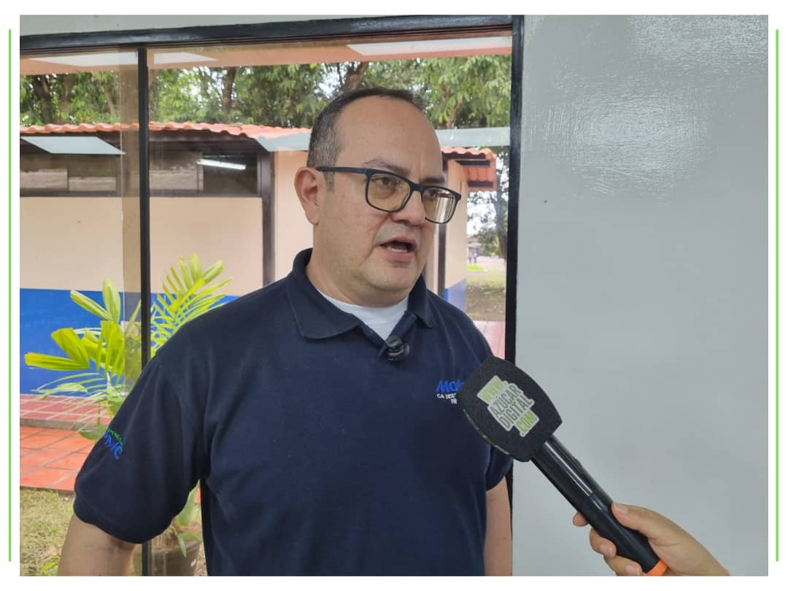

Venezuela posee un potencial extraordinario para la producción de biomasa, gracias a sus privilegiadas condiciones tropicales, de suelos y agua.

En un contexto donde la diversificación económica se hace indispensable, la **Bioeconomía surge como el paradigma clave** que redefine la actividad agrícola nacional, permitiendo que los recursos biológicos y sus residuos dejen de verse como simples desechos y pasen a transformarse en fuentes de energía sostenible.

Un ejemplo concreto de este potencial desarrollo nos lo presenta el periodista **Daniel España** en su reportaje  publicado en el portal **www.azucardigital.com** , el cual transcribimos a continuación,  donde mediante una entrevista, explica cómo el bagazo de la caña de azúcar, tradicionalmente aprovechado de forma interna, podría cuadruplicar su capacidad de generación eléctrica mediante la incorporación de calderas y turbo generadores de tecnología de punta. No obstante, para materializar este aporte al Sistema Interconectado Nacional, los centrales azucareros requieren  de condiciones nacionales habilitantes. Esto incluye no solo la atracción de inversión y el financiamiento de organismos multilaterales, sino principalmente el diseño de un marco legal y regulatorio claro que brinde seguridad jurídica y viabilidad económica a la transición hacia fuentes energéticas de bajo carbono.

## "Con inversión en tecnología de punta centrales MOLIPASA y El Palmar podrían generar hasta 60 megavatios de energía”

A juicio del ingeniero **Liner Antonio Bermúdez, Gerente Corporativo de Operaciones Industriales del Grupo de Empresas PMC**, el aporte de energía de los centrales azucareros para nutrir el **Sistema Interconectado Nacional** es factible, pero para ello se necesita que exista un marco regulatorio claro.

Manifiesta Bermúdez que en el área de turbo generación en los centrales azucareros, todo está inventado y se puede lograr, pero para trabajar con eficiencia y aportar mayor cantidad de energía se necesita una inversión importante que debe tener su retorno para garantizar factibilidad.

El ingeniero, quien tiene experiencia en turbo generación en la industria azucarera de Colombia, expresa que en el Grupo PMC se evalúa el tema y se tienen expectativas sobre el marco regulatorio para arrancar proyectos, pero antes debe determinarse si son viables técnica y económicamente.

>*«Los consumos internos de nuestras plantas se mueven actualmente en 5 megavatios, y la capacidad instalada de auto generación de energía es prácticamente el doble. Así, en este momento con lo que se tiene se podría estar aportando 5 megavatios por planta»* detalló.

Bermúdez, explica que los centrales azucareros MOLIPASA y El Palmar, aprovechando el bagazo que actualmente usan, con tecnología de punta podrían cuadruplicar la capacidad de generación de energía. Es decir, desarrollando un proyecto de inversión grande, cada uno podría generar 30 megavatios de energía, usar internamente 10 MW y **aportar al Sistema Nacional 20 MW cada uno, 40 megavatios en conjunto.**

Enfatizó el gerente que para este tipo de proyectos, la inversión es suficientemente importante, por lo tanto para acceder a esos recursos es indispensable gestionar un financiamiento de los organismos multilaterales.

El proyecto contemplaría adquirir calderas y turbo generadores con tecnología de punta, para así contar con máxima eficiencia. *«Así se hace en Colombia con proyectos de cogeneración eficientes»* afirmó.

**Articulo original:** Daniel España, [Azúcar Digital](https://azucardigital.com/noticias/con-inversion-en-tecnologia-de-punta-centrales-molipasa-y-el-palmar-podrian-generar-hasta-60-megavatios-de-energia/)

