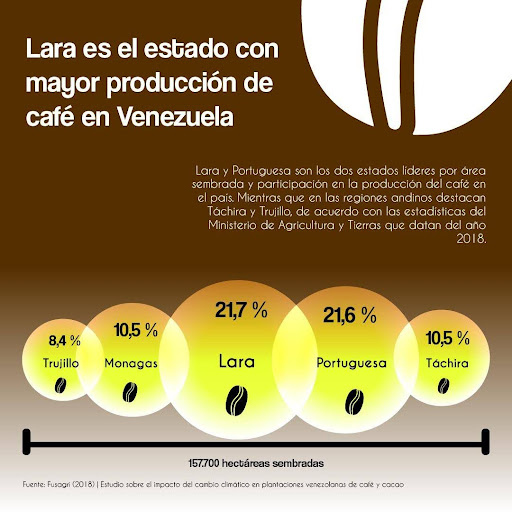
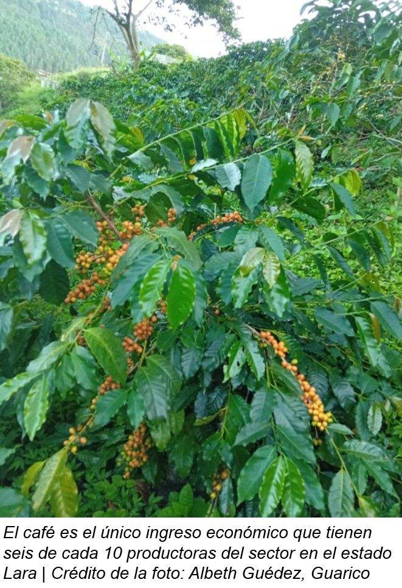
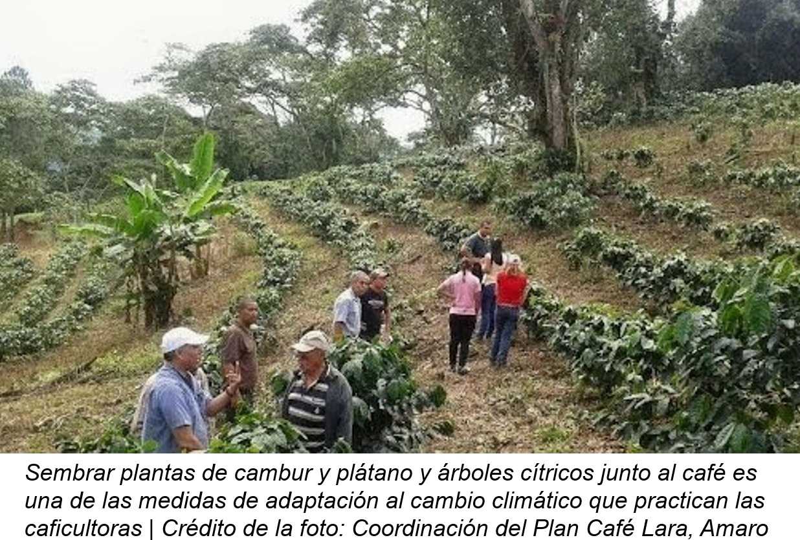
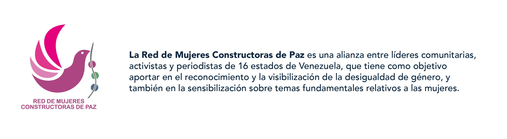

**Maura Montilla** es capaz de explicarle a cualquier persona, con el ritual del café por las mañanas, cómo es que el cambio climático les afecta, de forma directa, en sus vidas. A mayor cantidad de lluvias intensas sobre los cafetales, peores frutos del café. A más plantaciones expuestas al sol directo y con más calor, peor sabor del café.

Ella lo sabe bien porque es productora cafetalera y dedica sus días a lograr el mejor sabor posible del café. Es parte de la *Asociación de caficultores Río Claro* del estado Lara. Ahora, cursa un diplomado de “Maestro cafetalero” promovido por la *Corporación Venezolana del Café*. Es también parte de un grupo de productoras que lideran una adaptación silenciosa de las plantaciones para preservar la calidad del café venezolano. 

>“Hemos visto transformaciones drásticas con el café en los últimos cinco o seis años. Hemos visto al cambio climático como una afectación pronunciada en nuestras plantaciones. Por eso, tomamos algunas estrategias para adaptarnos”, explicó Maura Montilla, caficultora del estado Lara, en entrevista a mediados de octubre pasado.  

Un café con sabor más amargo y con menos aroma es parte de las consecuencias directas de los cafetales expuestos a temperaturas más altas y con estrés hídrico. Dos escenarios climáticos proyectados para el futuro del país, como lo marcan las conclusiones del 
[**Primer Reporte Académico de Cambio Climático de Venezuela.**](https://acfiman.org/obras/primer-reporte-academico-de-cambio-climatico-de-venezuela-pracc/)

Los impactos del cambio climático a los cafetales venezolanos, sin embargo, son más amplios que un simple cambio en el sabor o en la calidad del café. La amenaza es que zonas cafetaleras completas pierdan la capacidad para cosechar café venezolano en apenas 15 años. 

**Bajo la sombra**

La meta de Maura Montilla es que el café que ella cosecha junto a su esposo, Honoro Castillo, pueda exportarse a Europa. El primer paso de ese camino lo logró apenas este año, cuando finalmente obtuvo el certificado para la marca comercial de su café **Montcast**, por parte del *Servicio Autónomo de Propiedad Intelectual (SAPI)*.

Para abrirse un puesto entre los café de especialidad, esa gama de grano arábica con mejor sabor al paladar y un precio mayor para los agricultores, implementó un secado lento del producto en invernaderos.

Ella apostó también por hacer la recolección del fruto en tres o cuatro tandas diferentes durante la cosecha que se extiende, por lo general, entre octubre y marzo. Este proceso conocido como "graneos"" le permite obtener los frutos más maduros y con mejor calidad. Aunque la medida más importante es que sus cafetales crecen ahora bajo la sombra. 

>“El café puede darse a pleno sol, pero no tiene la misma calidad. La planta se estresa más rápido. Si se tiene mucho sol, sin sombra, va a ser dañino para la floración y, por ende, para el fruto. Con la temperatura tan alta afecta, la reducción de la calidad del grano. La fórmula que usamos es 70 % de sol y 30 % de sombra, eso para que la floración sea espectacular y el fruto sea grande”, detalló Montilla. 

Su modelo de sombra controlada es parte de las adaptaciones que también usan otras caficultoras. La siembra alrededor de árboles frutales de limón, mandarinas o aguacates es una de las técnicas empleadas para regalarles sombra a los cafetales en el estado Lara, que es el mayor productor de café en el país, si se consideran las estadísticas más recientes del Ministerio de Agricultura y Tierras fechadas en 2018. 

>“Las mujeres no sólo son conscientes de la afectación que tiene el café por consecuencias del clima, sino que además están sensibilizadas y lo consideran como uno de los problemas principales de la baja en la producción. La mayoría de las caficultoras ahora siembra bajo sombra y algunas ya iniciaron sus propios viveros de sombra”, relató la ingeniera agrónoma Carmen Torrealba. 

Torrealba es también especialista en Desarrollo Sostenible y estuvo al frente del equipo que entrevistó a 36 caficultoras de El Volcán, El Cauro, El Rincón, Palo Grande, Quebrada Arriba, Cerro Santa Bárbara, Guavillal, Estación y Vigía Nueva. Todas comunidades pertenecientes al eje sureste del estado Lara, ubicadas en un rango entre 964 y 1.447 metros sobre el nivel del mar y conocidas por ser zonas cafetaleras.

Este [**estudio**](https://www.fusagri.com/publication/estudio_perfil/), publicado por la *Fundación Servicio para el Agricultor (Fusagri)* con el apoyo del *Instituto Interamericano de Cooperación para la Agricultura (IICA)*, encontró que la mayoría de las caficultoras encuestadas (80 %) les siembra árboles a sus plantaciones de café. 

“Hay mujeres que tienen menos de tres años incorporando sombra y otras más de 10 años”, apuntó la ingeniera agrónoma Torrealba

Apenas una de cada 10 caficultoras en el estado Lara (14 %) expone a sus cafetales al sol directo. Se trata de una práctica común en Guárico y Sucre, que también forman parte de los 20 estados productores del café en el país. 

La inclusión de una mayor sombra a sus cafetales es una adaptación para paliar los efectos climáticos. Aunque también se trata de una alternativa para contar con cultivos adicionales de cambur, plátanos, aguacate y cacao, lo que les ayuda a disponer de otras opciones alimenticias para sus familias y, a la vez, aumentar el dinero que entra a sus hogares.

El café, después de todo, se trata del único ingreso económico para seis de cada 10 productoras encuestadas por [**FUSAGRI**](https://www.fusagri.com/). Su precio en el mercado venezolano fue acordado entre los 150 dólares y 200 dólares por quintal en septiembre pasado. El café de especialidad como el producido para Montcast espera venderse por encima de esos 200 dólares por quintal para comienzos de 2025, porque se trata de los granos con mayor calidad. 

El dinero también fue el gran impulsor de otra de las grandes adaptaciones al cambio climático que ahora se práctica en el estado Lara: la incorporación de fertilizantes orgánicos.

Cuando los precios de la urea subieron de 13 a 35 dólares por saco, las productoras optaron por disminuir las aplicaciones y la cantidad rociada de este fertilizante químico a sus plantaciones. El esquema se redujo sólo a una aplicación al comienzo de las lluvias y, otra más, después de la cosecha.

Pero lo más interesante es que casi la mitad de las entrevistadas en la investigación (47 %) ahora combina la urea con otros fertilizantes orgánicos como el estiércol de chivo y la propia pulpa de café (broza) para sus plantaciones.  

**Dueñas y señoras de su café** 

Las caficultoras larenses ahora deciden sobre los fertilizantes usados, pero también en otras fases claves de esta cadena agrícola. Desde la plantación y mantenimiento, pasando por la cosecha y comercialización, hasta el almacenamiento y el beneficio final. Esto ocurre porque la mayoría tiene unidades productivas pequeñas de alrededor de 2,5 hectáreas dominadas por el café. 

>“La mujer venezolana es más protagónica y tiene un don de mando diferente. En el caso del café, hay algo que se nota. Es que detrás de ese papá, esposo o hermano, tienen un rol muy importante en la parte administrativa. Es la mujer quien maneja los bancos y las redes (sociales). Es la que cuenta, le paga a los obreros, está pendiente de que no se roben el café y es más metódica. Creo que ya superamos ese 20 % de la participación de mujeres en el café”, expuso Vicente Pérez, director ejecutivo de la Confederación de Asociaciones de Productores Agropecuarios de Venezuela (FEDEAGRO) y caficultor. 

El primer escalón del empoderamiento femenino en el sector cafetalero llegó de la mano de las labores administrativas en el núcleo familiar. Luego, se unió con la herencia de algunas porciones de tierra. Hoy, en cambio, más de la mitad de las productoras cafetaleras (53 %) del estudio realizado en el estado Lara son solteras, separadas, divorciadas o viudas y son las responsables absolutas de sus parcelas de café. 

>“Ahorita estamos trabajando, como se dice, "mano vuelta". Tú me ayudas un día, yo te ayudo otro día. No hay plata para decir que vas a pagar a un trabajador o a un hombre, tenemos que trabajar nosotras con nuestra propia mano”, como lo relató la caficultora Luz Rivero Luque del sector Centro en la investigación de FUSAGRI. 

La  [**Organización Internacional del Café (IOC)**](https://www.ico.org/documents/cy2017-18/icc-122-11e-gender-equality.pdf) habla de una participación femenina entre 20 % y 30 % en las unidades productivas y esa estadística coincide con el escenario venezolano. 

Los hombres continúan como la gran mayoría de los productores de café venezolano, aunque los estudios más recientes de FUSAGRI hablan de una participación de las mujeres de 23,2 % en las unidades productivas cafetaleras larenses. Esta representación llega incluso a 25,6 % en la parroquia Hilario Luna y Luna en el estado Lara.

Esta creciente participación femenina es clave para entender las nuevas adaptaciones en las plantaciones cafetaleras larenses, pero puede serlo aún más en los próximos 15 años.  [**FUSAGRI ya advirtió**](https://www.fusagri.com/publication/cambioclimatico_cafe/) que gran parte de la tierra del eje cafetalero del estado Lara *“podrá dejar de ser apta para café”* en la medida que aumenten las temperaturas y se extienda la duración de los períodos secos a partir del año 2040. 

El buen sabor del café venezolano parece jugarse ahora sus movimientos decisivos y, sin duda, la sensibilidad femenina y su trabajo asociativo pueden ser las grandes herramientas para empezar un camino que también necesita de más biofertilizantes, más patios de secado de café cubiertos y apoyo formativo para lidiar con la preservación del suelo y el agua

Este trabajo [forma parte del ciclo de participación de un grupo de periodistas becarios dentro del proyecto que adelanta Clima 21: “Caminos hacia la resiliencia climática”](https://clima21.net/noticias/calor-extremo-amenaza-fragil-subsistencia-de-trabajadoras-informales-en-maracaibo/), el cual busca incidir con acciones urgentes en las políticas públicas nacionales para la protección de las poblaciones más vulnerables al cambio climático.

**Fuente:** [TEJIENDO REDES – Constructoras de Paz en Venezuela](https://ipysvenezuela.org/tejiendo-redes/noticia/caficultoras-larenses-lideran-adaptacion-climatica-del-cafe-en-venezuela/)
